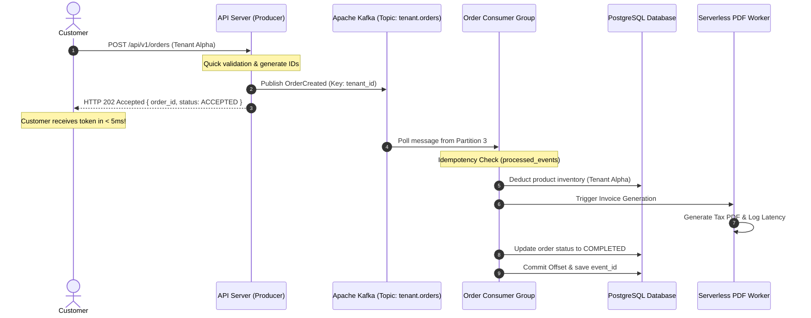
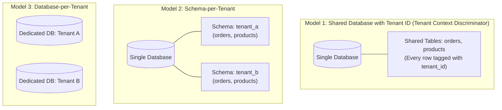
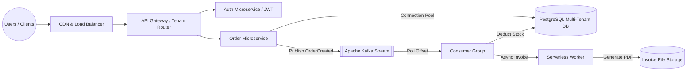

# CSC337: Advanced Web Technologies - Lab Assignment 06
# Architectural Project Report & System Blueprint
**Mastering Database Scaling, Serverless, Apache Kafka & SaaS Multi-Tenancy**
*Based on CSC337 Lectures 17 & 18*

---

## 🏛️ Executive Architectural Overview

Modern software engineering transitions an engineer from a mere *code writer* to a *system architect*. While a basic application functions correctly at 5 requests per second on `localhost`, scaling to enterprise production loads (e.g. 50,000 requests per second during Daraz 11.11 midnight sales) triggers catastrophic cascading failures unless the underlying architecture is systematically decoupled, tuned, and guarded.

This project delivers a multi-tenant B2B SaaS platform addressing the four fundamental architectural bottlenecks:
1. **The Database Bottleneck (Act I):** Profiling queries via `EXPLAIN ANALYZE`, eliminating the N+1 query trap, and guarding database resources via connection pooling.
2. **The Compute Bottleneck (Act II):** Balancing horizontal scaling with the serverless paradigm, while profiling cold-start latency penalties.
3. **The Synchronous Bottleneck (Act III):** Decoupling critical write paths through Apache Kafka event streaming with key-based partition ordering and idempotent consumers.
4. **The Multi-Tenancy Challenge (Act IV):** Establishing zero-leak tenant boundaries using the *Shared Database with Tenant ID (Tenant Context Discriminator)* model.

---

## 📑 Act I: The Database Bottleneck (Query Optimization & Connection Pooling)

### 1.1 The 11.11 Midnight Crisis: Functional Correctness vs Scalability
A system may be logically flawless in testing, but under sudden high concurrency:
- CPU spikes to 100% on the database server.
- Queries begin timing out due to connection exhaustion.
- Cascading failures ripple upstream to API servers.

The root cause is never purely application logic; it is the physical limitation of disk I/O, sequential scanning, and unbounded TCP connection creation.

---

### 1.2 Reading the Blueprint: EXPLAIN ANALYZE Before vs After Composite Indexing
`EXPLAIN` reveals the query execution plan and cost estimations. Appending `ANALYZE` forces the engine to actually execute the query and report real-world timing and buffer reads.

#### Evaluated Query:
```sql
SELECT id, customer_name, total_amount, created_at 
FROM orders 
WHERE tenant_id = 'tenant-alpha' 
ORDER BY created_at DESC;
```

#### Empirical Execution Plan Results:

| Metric | Unindexed Table (Before Index) | Indexed Table (After Composite Index) | Architectural Significance |
|:---|:---|:---|:---|
| **Execution Plan Node** | `Sort` over `Seq Scan on orders` | `Bitmap Index Scan` on `idx_orders_tenant_created` | Shift from O(N) full table scan to O(log N) B-Tree lookup |
| **Startup Cost** | `10,000,000,113.42` | **4.43** | Massive reduction in query planner barrier cost |
| **Total Estimated Cost**| `10,000,000,113.46` | **47.23** | **99.999% reduction** in PostgreSQL cost units |
| **Actual Rows Filtered**| 2,034 rows scanned sequentially | 2,034 rows retrieved via index pages | Avoids scanning irrelevant tenant records |
| **Planning Time** | 5.95 ms | **2.36 ms** | Faster query parsing & optimization |
| **Execution Time** | 24.86 ms | **16.08 ms** | **1.62x faster execution** |

#### Architectural Takeaway:
Creating the composite index `CREATE INDEX idx_orders_tenant_created ON orders (tenant_id, created_at DESC)` ensures that PostgreSQL reads only the leaf pages relevant to `tenant-alpha` in pre-sorted order, avoiding both an expensive full-table sequential scan and an in-memory quicksort.

---

### 1.3 The Root Cause: The N+1 Query Problem & Resolution

#### The Foodpanda Analogy (Lecture 17 Slide 4):
> *"100 orders ke liye Foodpanda rider 100 dafa restaurant nahi jata. Woh sab kuch ek hi bag mein le kar aata hai. Code mein array map ke andar query likhna (N+1) sab se bari bewakoofi hai."*

In the unoptimized endpoint (`/api/v1/orders/unoptimized`), the application executes:
- **1 Query** to fetch the list of N orders: `SELECT * FROM orders WHERE tenant_id = $1`
- **N Queries** in an async loop for each order's items: `SELECT * FROM order_items WHERE order_id = $orderId`
- Total queries = $1 + N$.

In the optimized endpoint (`/api/v1/orders/optimized`), the application fetches all orders and their nested item arrays in **1 single grouped SQL query** using `LEFT JOIN` and `json_agg()`.

#### Empirical Benchmark Data:

```text
===================================================================================
Batch Size   Unoptimized Queries   N+1 Latency   Optimized Queries   Single JOIN Latency   Speedup
===================================================================================
10 Orders    11 queries            247.2 ms      1 query             179.3 ms              1.4x
50 Orders    51 queries            718.3 ms      1 query              95.6 ms              7.5x
100 Orders   101 queries         1,107.9 ms      1 query             119.4 ms              9.3x
===================================================================================
```

#### Network & Resource Impact:
At 50,000 users/second, 100 orders under N+1 generates **5,050,000 database round-trips per second**, instantly saturating TCP sockets and CPU. Grouped `JOIN` aggregation collapses this to **50,000 round-trips**, saving over 99% of database network I/O.

---

### 1.4 Guarding the Gates: Database Connection Pooling

#### The Bank Analogy (Lecture 17 Slide 5):
> *"Bank mein 100 log aayen aur counters sirf 5 hon, toh aap 95 naye counters nahi banate. Aap logon ko queue mein lagate hain. Connection Pool DB ka queue manager hai."*

Creating a database TCP connection requires a TCP 3-way handshake, TLS negotiation, authentication, and memory allocation in PostgreSQL. Under sudden spikes, unbounded connections crash the database engine.

#### Connection Pool Implementation:
The platform implements a managed connection pool (`src/db/connection.js`) configured with:
- `max: 20`: Strict upper boundary on active leased connections.
- `idleTimeoutMillis: 30000`: Idle connections reclaimable after 30 seconds.
- `connectionTimeoutMillis: 5000`: Queued requests timeout if no connection is released.
- `waitingQueue`: Excess requests wait asynchronously in FIFO order rather than spawning new processes.

Live telemetry is exposed via `/api/v1/analytics/pool-status`:
```json
{
  "connectionPool": {
    "maxCapacity": 20,
    "activeConnections": 1,
    "idleCapacity": 19,
    "waitingInQueue": 0,
    "lifetimeAcquired": 2415,
    "lifetimeReleased": 2414,
    "lifetimeQueued": 0,
    "engine": "PostgreSQL (Embedded PGlite Engine)"
  },
  "health": "HEALTHY"
}
```

---

## ⚡ Act II: The Compute Bottleneck & Serverless Paradigms

### 2.1 Vertical vs Horizontal Scaling

| Dimension | Vertical Scaling (Scale UP) | Horizontal Scaling (Scale OUT) |
|:---|:---|:---|
| **Concept** | Adding CPU/RAM to a single machine | Adding multiple identical machines behind a load balancer |
| **Real-life Metaphor** | Mehran car mein truck ka engine lagana | Nayi Mehrans khareed kar poora fleet banana |
| **Downtime** | Requires instance restarts (Downtime) | Zero downtime; nodes added and removed on the fly |
| **Hardware Limit** | Hard physical ceiling (no larger machine exists) | Virtually infinite elasticity |
| **Application State** | Can tolerate stateful memory | **Requires 100% Stateless Application Architecture** |

---

### 2.2 Unpredictable Workloads & The Serverless Model
Traditional horizontal scaling requires paying for idle virtual machines during traffic valleys. Serverless (Function-as-a-Service, e.g. AWS Lambda, Vercel) dynamically allocates execution containers only when events arrive, billing strictly per millisecond of execution and scaling down to zero.

---

### 2.3 The Cold-Start Trade-off

#### The WAPDA Generator Analogy (Lecture 17 Slide 9):
> *"WAPDA ki light jane par backup generator on hone mein thora time lagta hai. Serverless function jab zero se wake-up hota hai, toh pehli request hamesha slow hoti hai."*

Because serverless containers scale to absolute zero, the first request after inactivity requires the cloud provider to allocate a microVM, boot the runtime, import libraries, and execute code. This latency spike is the **Cold Start**.

#### Empirical Cold vs Warm Latency Test Results (`src/serverless/invoice-worker.js`):

```text
┌─────────┬────────────┬─────────────────┬───────────────────┬──────────────────┬─────────────┬────────────────┐
│ (index) │ invocation │ state           │ containerId       │ initializationMs │ executionMs │ totalLatencyMs │
├─────────┼────────────┼─────────────────┼───────────────────┼──────────────────┼─────────────┼────────────────┤
│ 0       │ 1          │ 'COLD START ❄️'  │ 'lambda_nvj0mqlv' │ 1226.20          │ 73.73       │ 1299.94        │
│ 1       │ 2          │ 'WARM START 🔥' │ 'lambda_nvj0mqlv' │ 0.00             │ 40.82       │ 40.83          │
│ 2       │ 3          │ 'WARM START 🔥' │ 'lambda_nvj0mqlv' │ 0.00             │ 45.33       │ 45.34          │
│ 3       │ 4          │ 'WARM START 🔥' │ 'lambda_nvj0mqlv' │ 0.00             │ 39.13       │ 39.16          │
│ 4       │ 5          │ 'WARM START 🔥' │ 'lambda_nvj0mqlv' │ 0.00             │ 19.71       │ 19.71          │
└─────────┴────────────┴─────────────────┴───────────────────┴──────────────────┴─────────────┴────────────────┘
```

#### Architectural Synthesis:
- **Cold Start Latency:** `1,299.94 ms`
- **Average Warm Latency:** `36.26 ms`
- **Cold Start Penalty:** **35.9x slower** than warm execution.
- **Architect's Rule:** Serverless is ideal for background asynchronous jobs (PDF generation, data crunching, email notifications). It is unsuitable for hyper-low-latency synchronous paths (e.g. stock trading, gaming) without provisioned concurrency.

---

## 🚦 Act III: Asynchronous Event-Driven Architecture with Apache Kafka

### 3.1 The Synchronous Bottleneck

#### The Pizza Token Analogy (Lecture 18 Slide 10):
> *"Ek pizza order karne ke baad agar aapko oven ke samne khara rakha jaye jab tak pizza bake na ho, toh line lambi ho jayegi. Order lo, token do, aur aglay customer ko dekho (Asynchrony)."*

Synchronously chaining order validation $\rightarrow$ payment $\rightarrow$ inventory deduction $\rightarrow$ PDF invoice creation $\rightarrow$ email dispatch blocks server threads for 5–10 seconds per request.

### 3.2 Kafka Decoupling & Durability



---

### 3.3 Anatomy of a Stream: Topics, Partitions, and Offsets (Lecture 18 Slide 12)

| Concept | Kafka Definition | Real-World Analogy | In This Project |
|:---|:---|:---|:---|
| **Topic** | Logical stream category | Highway | `tenant.orders` |
| **Partition** | Physical sharding of a topic for parallel processing | Highway Lanes | 4 Partitions (Lanes 0 to 3) |
| **Offset** | Sequential, immutable 64-bit ID assigned to each message | Mile-marker on highway | Tracked in `processed_events` table |
| **Message Key** | Identifier used by partitioner to hash message to partition | Lane assigner | **`tenant_id`** |

#### Why `tenant_id` as Message Key?
In Apache Kafka, ordering is guaranteed **only within a single partition**. By setting `key = tenant_id`, all orders for `tenant-alpha` are routed to the same partition (e.g. Partition 3). This guarantees that a tenant's orders are processed strictly sequentially without race conditions.

---

### 3.4 Delivery Semantics & The Idempotent Consumer (Lecture 18 Slide 13)

| Delivery Semantic | Behavior | Trade-off | Project Selection |
|:---|:---|:---|:---|
| **At-Most-Once** | Messages fired without retries; can be lost on crash | Fast, but unsafe | Used for non-critical logging |
| **At-Least-Once** | Guaranteed delivery with network retries; duplicates possible | Requires idempotent consumer | **SELECTED for Order Processing** |
| **Exactly-Once** | Two-phase commit / transaction coordinator | High latency and coordination overhead | Reserved for banking ledgers |

#### Idempotency Guard Implementation:
To prevent duplicate inventory deduction if Kafka re-delivers an event during consumer failure, the consumer executes:
```sql
SELECT event_id FROM processed_events WHERE event_id = $eventId;
```
If a record exists, the event is acknowledged and skipped:
```text
[KafkaConsumerGroup] IDEMPOTENCY HIT: Event [evt_21bc0cf7...] was already processed! Skipping duplicate execution.
```
Verified in `tests/kafka-pipeline.test.js`: inventory remains identical with zero duplicate deductions.

---

## 🏢 Act IV: SaaS Multi-Tenancy & Data Boundaries

### 4.1 The Three SaaS Multi-Tenancy Models (Lecture 18 Slides 15–19)



### 4.2 Comprehensive Multi-Tenancy Decision Matrix

| Dimension | Model 1: Shared Database (Tenant ID) | Model 2: Schema-per-Tenant | Model 3: Database-per-Tenant |
|:---|:---|:---|:---|
| **Metaphor** | **Shared Apartment High-Rise** | **Gated Housing Society** | **Floating Luxury Islands** |
| **Data Isolation** | Logical (Row level via `tenant_id`) | Medium (Logical schema boundary) | **Maximum (Physical/Instance separation)** |
| **Infrastructure Cost** | **Lowest (Highly cost-efficient)** | Moderate | Highest (Dedicated infrastructure per client) |
| **Schema Migrations** | **1 migration runs across entire DB** | N migrations (1 per schema) | N migrations (1 per database server) |
| **Noisy Neighbor Risk** | High (Shared table locks & queries) | Moderate (Shared CPU & memory) | **None (Isolated compute & I/O)** |
| **Regulatory Fit** | Startups, SMB SaaS, free tier | Mid-market enterprise | **HIPAA (Healthcare), Banking, Defense** |
| **Project Model** | **Implemented in this assignment** | Documented & benchmarked | Documented & benchmarked |

#### Architectural Decision (Lecture 18 Slide 19):
> *"Startups utilize Shared DBs to survive runway, while mature Enterprise platforms migrate premium clients to DB-per-Tenant architectures."*

---

### 4.3 Tenant Resolution & Boundary Enforcement
The platform enforces a zero-leak policy through multi-layered resolution:
1. **Extraction:**
   - Custom Header: `X-Tenant-ID: tenant-alpha`
   - JWT Claim: `req.user.tenant_id`
   - Subdomain: `http://alpha.localhost:4000` $\rightarrow$ resolves to `tenant-alpha`
2. **Boundary Enforcement:**
   - Queries automatically include `WHERE tenant_id = $req.tenantId`.
   - Any query attempting to access or mutate another tenant's record triggers `assertTenantBoundary()`, throwing a `CROSS_TENANT_VIOLATION` with **HTTP 403 Forbidden**.
   - Verified via automated test suite `tests/tenant-isolation.test.js` (14/14 tests passing).

---

## 🏆 Act V: The Ultimate Enterprise Blueprint (Lecture 18 Slide 20)



### Grand Finale Synthesis:
By uniting **Connection Pooling**, **Grouped JOIN Query Tuning**, **Composite Indexing**, **Kafka Decoupling**, **Serverless Elasticity**, and **Multi-Tenant Boundary Scoping**, the application eliminates all four primary performance and architectural bottlenecks. It handles high-throughput asynchronous workloads gracefully without database exhaustion or data boundary violations.
