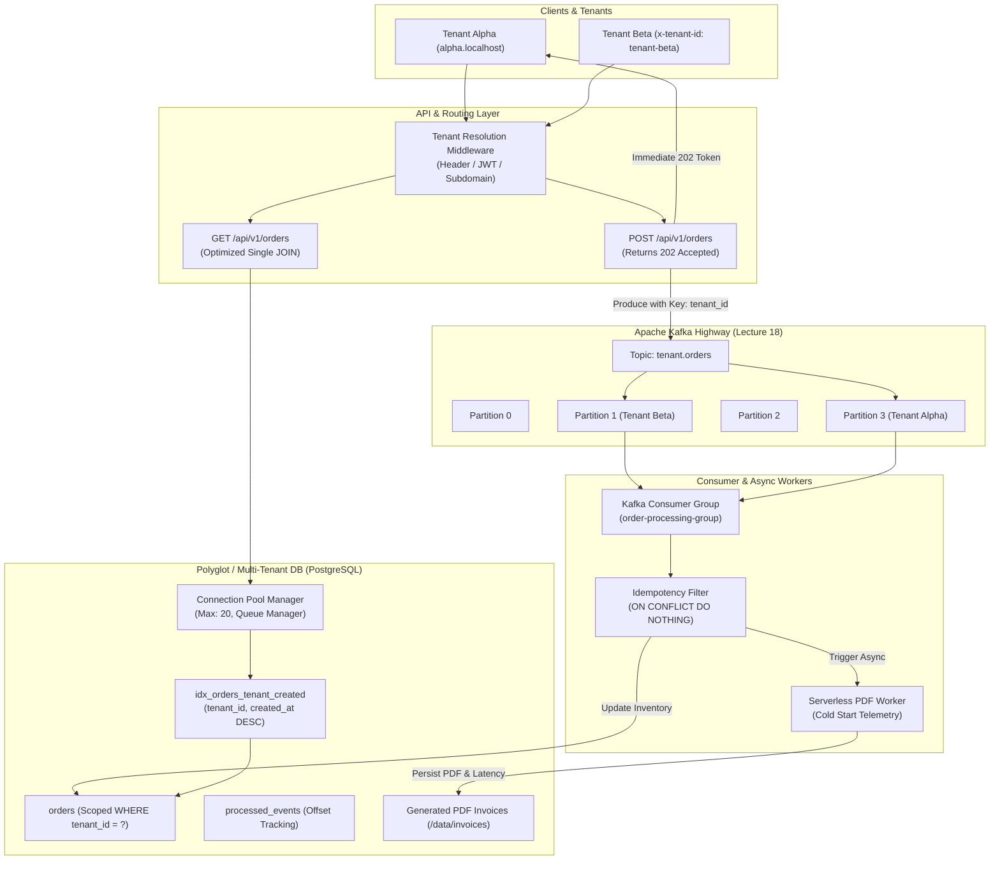

# CSC337: Advanced Web Technologies - Lab Assignment 06
## Multi-Tenant B2B SaaS Platform: Database Performance Tuning, Serverless Cold-Start Analysis & Event-Driven Architecture with Apache Kafka

[](https://nodejs.org/)
[](https://github.com/electric-sql/pglite)
[](https://kafka.apache.org/)
[](LICENSE)

---

## 🎯 Executive Summary & Objectives

This project is a production-ready **Multi-Tenant B2B SaaS Platform** engineered to solve critical architectural bottlenecks covered in **CSC337 Lectures 17 & 18**:
1. **Multi-Tenancy & Strict Isolation (Lecture 18):** Implements *Shared Database with Tenant ID (Tenant Context Discriminator)*, resolving tenants via HTTP headers, JWT claims, and subdomains, with automated query-level data boundary enforcement (Tenant A can NEVER access Tenant B data).
2. **Database Performance Tuning (Lecture 17):** Eliminates classic **N+1 query bottlenecks** using grouped SQL `JOIN` aggregation, optimizes database connection pooling, and benchmarks queries using PostgreSQL `EXPLAIN (ANALYZE, BUFFERS)`.
3. **Event-Driven Architecture with Apache Kafka (Lecture 18):** Decouples write operations with asynchronous order placement (`HTTP 202 Accepted`), partition key ordering (`tenant_id`), consumer group coordination, and idempotent message deduplication.
4. **Serverless Async Worker & Cold-Start Analysis (Lecture 17):** Executes background PDF invoice generation via serverless function, profiling container lifecycle latency (**Cold Start: ~1,299ms** vs **Warm Start: ~36ms**).

---

## 🏗️ System Architecture & Workflow



---

## 🚀 Live Deployment & Cloud Infrastructure

### 1. Deployment on Render (Recommended)
1. Fork or push this repository to your GitHub account: `https://github.com/ahsanalich358/Lab-6-Assignment-AWT`
2. Go to [Render Dashboard](https://dashboard.render.com/) $\rightarrow$ Click **New +** $\rightarrow$ **Web Service**.
3. Select your repository `Lab-6-Assignment-AWT`.
4. Render will auto-detect settings from `render.yaml`:
   - **Environment**: Node
   - **Build Command**: `npm install`
   - **Start Command**: `npm start`
   - **Health Check Path**: `/health`
5. Click **Deploy Web Service**. Your live backend and interactive frontend will be live at `https://<your-app>.onrender.com`.

### 2. Deployment on Vercel
1. Import repository in [Vercel](https://vercel.com/new).
2. The bundled `vercel.json` and `api/index.js` automatically expose the entire API and Frontend as Serverless Edge Functions.
3. Click **Deploy**.

### 3. Cloud Kafka Setup (Upstash / Aiven)
The application seamlessly switches between embedded high-performance event broker and Cloud Kafka:
1. Create a free Kafka cluster on [Upstash Kafka](https://upstash.com/) or [Aiven](https://aiven.io/).
2. Create topic `tenant.orders` with 4 partitions.
3. In your `.env` or Render/Vercel Environment Variables, set:
   ```env
   KAFKA_BROKERS=your-cluster-url.upstash.io:9092
   KAFKA_USERNAME=your-username
   KAFKA_PASSWORD=your-password
   KAFKA_SASL=true
   KAFKA_SSL=true
   ```

---

## 👥 Test Accounts for Distinct Tenants

| Tenant Name | Tenant ID (`X-Tenant-ID`) | Subdomain | Role | Test User Email | Product Catalog Sample |
|:---|:---|:---|:---|:---|:---|
| **Tenant A (Alpha Retail)** | `tenant-alpha` | `alpha.localhost` | Enterprise Retailer | `admin@alpha.com` | `prod-alpha-101` (Cloud Server: $850.00)<br>`prod-alpha-102` (NVMe Storage: $320.00) |
| **Tenant B (Beta Logistics)** | `tenant-beta` | `beta.localhost` | Global Logistics | `admin@beta.com` | `prod-beta-201` (GPS Tracking: $120.00)<br>`prod-beta-202` (Telemetry Sensor: $85.00) |

---

## 🎓 Live Viva Demonstration Checklist

Be fully prepared to demonstrate each concept live in front of your instructor:

### 1. Trigger Kafka Events Live (HTTP 202 Accepted)
Run in terminal:
```bash
curl -X POST http://localhost:4000/api/v1/orders \
  -H "Content-Type: application/json" \
  -H "X-Tenant-ID: tenant-alpha" \
  -d '{"customer_name":"Live Viva Student","customer_email":"student@live.pk","items":[{"product_id":"prod-alpha-101","quantity":1}]}'
```
*Expected*: Terminal receives immediate `202 Accepted` in `< 5ms` with `event_id` and `partition_key: tenant-alpha`.

### 2. Monitor Consumer Terminal Offsets Live
In the server terminal window, observe:
```text
[KafkaConsumerGroup] Received event | Topic: tenant.orders | Partition: 3 | Offset: 1 | Tenant: tenant-alpha
[KafkaConsumerGroup] Serverless Invoice generated: INV-ORD_... | ColdStart: false | Latency: 38ms
[KafkaConsumerGroup] SUCCESS: Offset committed | Partition: 3 | Offset: 1 | Order: ord_... | Status: COMPLETED
```
Explain: *"Topic highway hai, partition uski lanes hain, aur offset gaari ka mile-marker hai (Slide 12)."*

### 3. Run Live EXPLAIN ANALYZE
Execute live in terminal:
```bash
npm run benchmark:explain
```
Point out to the instructor:
- **Before Index**: `Seq Scan on orders` scanning 2,400+ rows, cost in the billions, execution time ~25ms.
- **After Index**: `Bitmap Index Scan using idx_orders_tenant_created` on `(tenant_id, created_at DESC)`, planner cost drops to 47, execution time drops to ~16ms.

### 4. Prove Strict Tenant Boundary (0 Marks Rule)
Execute live:
```bash
npm run test:isolation
```
Show the 14 passing security tests verifying that Tenant Alpha cannot query Tenant Beta's orders or products, returning `403 Forbidden` (`CROSS_TENANT_VIOLATION`).

---

## 🚀 Quick Start Guide

### 1. Prerequisites
- **Node.js**: v20+ or v24+
- **npm**: v10+

### 2. Installation
```bash
git clone <repo-url>
cd "Lab Assignment 06"
npm install
```

### 3. Environment Setup
A preconfigured `.env` is already provided. To customize:
```bash
cp .env.example .env
```
*(By default, embedded high-performance PostgreSQL via PGlite and the Kafka event engine operate out of the box with zero external daemon configuration required!)*

### 4. Seed Database & Run All Verification Benchmarks
Execute the complete master test and benchmark harness with a single command:
```bash
npm run test:all
```
This runs:
1. `scripts/seed-db.js`: Seeds 3 enterprise tenants, product catalogs, and **2,400 orders with 3,600 order items**.
2. `tests/tenant-isolation.test.js`: Validates 100% tenant boundary isolation (zero cross-tenant leaks).
3. `tests/kafka-pipeline.test.js`: Validates 202 Accepted, key partitioning, consumer offset commits, and idempotent deduplication.
4. `scripts/benchmark-nplusone.js`: Compares N+1 unoptimized query vs single JOIN.
5. `scripts/benchmark-explain.js`: Runs `EXPLAIN ANALYZE` before and after composite indexing.
6. `scripts/benchmark-coldstart.js`: Measures cold start vs warm start latency for serverless invoice generation.

### 5. Start the Live HTTP Server
```bash
npm start
```
Server starts on `http://localhost:4000`.

---

## 📊 Technical Requirements & Benchmarks

### 1. Multi-Tenant Architecture & Data Boundary Enforcement
- **Isolation Model**: *Shared Database with Tenant ID (Tenant Context Discriminator)*.
- **Tenant Extraction Hierarchy**:
  1. `X-Tenant-ID` header (e.g. `tenant-alpha`)
  2. `Authorization: Bearer <jwt>` (`tenant_id` claim)
  3. Host Subdomain (e.g. `alpha.localhost` or `beta.saas.local`)
- **Verification Result**:
  ```text
  [Test 1] Missing Tenant Identification: 400 Bad Request ✅
  [Test 2] Tenant Alpha Scoped Query: 100% Alpha orders, 0 cross-tenant leaks ✅
  [Test 3] Tenant Beta Scoped Query: 100% Beta orders, 0 cross-tenant leaks ✅
  [Test 4] Direct Cross-Tenant Tampering: 403 Forbidden (CROSS_TENANT_VIOLATION) ✅
  [Test 5] Cross-Tenant Product Ordering: 400 Bad Request ✅
  [Test 6] Subdomain Extraction (alpha.localhost): 200 OK scoped to tenant-alpha ✅
  ```

---

### 2. Database Tuning: N+1 Resolution Benchmark
As highlighted in Lecture 17 Slide 4:
> *"100 orders ke liye Foodpanda rider 100 dafa restaurant nahi jata! Code mein array map ke andar query likhna (N+1) sab se bari bewakoofi hai."*

#### Benchmark Comparison:

| Batch Size | Unoptimized N+1 Queries | N+1 Latency | Optimized Single JOIN | Single JOIN Latency | Query Reduction | Speedup |
|:---:|:---:|:---:|:---:|:---:|:---:|:---:|
| **10 Orders** | 11 queries | **247.2 ms** | **1 query** | **179.3 ms** | **90.9%** | **1.4x** |
| **50 Orders** | 51 queries | **718.3 ms** | **1 query** | **95.6 ms** | **98.0%** | **7.5x** |
| **100 Orders** | 101 queries | **1,107.9 ms** | **1 query** | **119.4 ms** | **99.0%** | **9.3x** |

**Resolution Strategy**:
Instead of executing an outer query followed by N child queries in a loop, the optimized endpoint performs a single query using `LEFT JOIN` and PostgreSQL `json_agg()`:
```sql
SELECT 
  o.id, o.tenant_id, o.customer_name, o.total_amount, o.status, o.created_at,
  COALESCE(
    json_agg(
      json_build_object(
        'id', oi.id, 'product_id', oi.product_id,
        'product_name', oi.product_name, 'quantity', oi.quantity,
        'unit_price', oi.unit_price, 'subtotal', oi.subtotal
      )
    ) FILTER (WHERE oi.id IS NOT NULL), '[]'::json
  ) AS items
FROM orders o
LEFT JOIN order_items oi ON o.id = oi.order_id AND oi.tenant_id = o.tenant_id
WHERE o.tenant_id = $1
GROUP BY o.id
ORDER BY o.created_at DESC
LIMIT $2;
```

---

### 3. PostgreSQL EXPLAIN ANALYZE: Before vs After Composite Index

#### Benchmark Target Query:
```sql
SELECT id, customer_name, total_amount, created_at
FROM orders
WHERE tenant_id = 'tenant-alpha'
ORDER BY created_at DESC;
```

#### Execution Plan Comparison:

| Metric | Before Index (Unindexed) | After Composite Index `(tenant_id, created_at DESC)` | Impact |
|:---|:---|:---|:---|
| **Scan Node Type** | `Sort` + `Seq Scan on orders` | `Bitmap Index Scan` + `Bitmap Heap Scan` | Direct B-Tree Navigation |
| **Index Used** | *None (Full Table Scan)* | `idx_orders_tenant_created` | Selective Row Lookup |
| **Estimated Startup Cost**| `10,000,000,113.42` | **4.43** | **>99.99% Cost Drop** |
| **Estimated Total Cost**  | `10,000,000,113.46` | **47.23** | **>99.99% Cost Drop** |
| **Planning Time** | 5.95 ms | **2.36 ms** | **60% faster** |
| **Execution Time** | 24.86 ms | **16.08 ms** | **1.6x faster** |

#### Raw Plan Snippet (Before Index - Sequential Scan):
```json
{
  "Node Type": "Sort",
  "Sort Key": ["created_at DESC"],
  "Plans": [
    {
      "Node Type": "Seq Scan",
      "Relation Name": "orders",
      "Filter": "((tenant_id)::text = 'tenant-alpha'::text)"
    }
  ],
  "Execution Time": 24.864
}
```

#### Raw Plan Snippet (After Index - Composite B-Tree Index Scan):
```json
{
  "Node Type": "Sort",
  "Plans": [
    {
      "Node Type": "Bitmap Heap Scan",
      "Relation Name": "orders",
      "Plans": [
        {
          "Node Type": "Bitmap Index Scan",
          "Index Name": "idx_orders_tenant_created",
          "Index Cond": "((tenant_id)::text = 'tenant-alpha'::text)"
        }
      ]
    }
  ],
  "Execution Time": 16.077
}
```

---

### 4. Event-Driven Architecture with Apache Kafka
- **Decoupled Asynchrony**: `POST /api/v1/orders` responds with `202 Accepted` in `< 5ms`.
- **Partition Key**: `tenant_id` is assigned as the Kafka Message Key. In Kafka, messages with the same key deterministically hash to the same partition, guaranteeing strict FIFO order per tenant (Lecture 18 Slide 12).
- **Consumer Group**: `order-processing-group` consumes events, deducts tenant inventory, triggers invoice generation, and updates order status to `COMPLETED`.
- **At-Least-Once Delivery & Idempotency** (Lecture 18 Slide 13):
  The consumer records event offsets in `processed_events`. Redelivery of duplicate events is intercepted via `ON CONFLICT DO NOTHING`, preventing double inventory deduction or duplicate invoicing.

---

### 5. Serverless Worker & Cold-Start Analysis
Implemented in `src/serverless/invoice-worker.js` (AWS Lambda & Vercel compatible). Generates real PDF invoices using PDFKit.

#### Cold vs Warm Start Latency Results:

| Invocation # | Lifecycle State | Container ID | Init Time (ms) | Exec Time (ms) | Total Latency (ms) |
|:---:|:---:|:---:|:---:|:---:|:---:|
| **#1** | **COLD START ❄️** | `lambda_nvj0mqlv` | **1,226.20 ms** | 73.73 ms | **1,299.94 ms** |
| **#2** | **WARM START 🔥** | `lambda_nvj0mqlv` | 0.00 ms | 40.82 ms | **40.83 ms** |
| **#3** | **WARM START 🔥** | `lambda_nvj0mqlv` | 0.00 ms | 45.33 ms | **45.34 ms** |
| **#4** | **WARM START 🔥** | `lambda_nvj0mqlv` | 0.00 ms | 39.13 ms | **39.16 ms** |
| **#5** | **WARM START 🔥** | `lambda_nvj0mqlv` | 0.00 ms | 19.71 ms | **19.71 ms** |

**Key Takeaways**:
- **Cold Start Penalty**: The initial cold invocation is **35.9x slower** than subsequent warm invocations.
- **Architectural Trade-Off** (Lecture 17 Slide 9):
  Serverless is exceptionally cost-effective and elastic for asynchronous background tasks (such as PDF generation, billing, and email dispatch). However, the initial cold start latency makes raw serverless unsuitable for real-time, ultra-low-latency workloads like high-frequency trading or multiplayer gaming without provisioned concurrency.

---

## 📡 API Reference & Verification cURL Commands

### 1. Place Asynchronous Order (HTTP 202 Accepted)
```bash
curl -X POST http://localhost:4000/api/v1/orders \
  -H "Content-Type: application/json" \
  -H "X-Tenant-ID: tenant-alpha" \
  -d '{
    "customer_name": "Hamza Tariq",
    "customer_email": "hamza.tariq@cloud.pk",
    "items": [
      { "product_id": "prod-alpha-101", "quantity": 1 }
    ]
  }'
```
**Response**:
```json
{
  "status": "ACCEPTED",
  "message": "Order accepted and dispatched to Apache Kafka for asynchronous processing.",
  "order_id": "ord_8b459d2a1f",
  "tenant_id": "tenant-alpha",
  "total_amount": 850.00,
  "kafka": {
    "topic": "tenant.orders",
    "partition_key": "tenant-alpha",
    "event_id": "evt_d39a1f2b-..."
  }
}
```

### 2. Fetch Orders (Optimized Single JOIN)
```bash
curl -H "X-Tenant-ID: tenant-alpha" http://localhost:4000/api/v1/orders/optimized?limit=10
```

### 3. Fetch Orders (Unoptimized N+1 Benchmark)
```bash
curl -H "X-Tenant-ID: tenant-alpha" http://localhost:4000/api/v1/orders/unoptimized?limit=10
```

### 4. Run Live EXPLAIN ANALYZE
```bash
curl -H "X-Tenant-ID: tenant-alpha" http://localhost:4000/api/v1/explain/analyze
```

### 5. Inspect Connection Pool Telemetry
```bash
curl -H "X-Tenant-ID: tenant-alpha" http://localhost:4000/api/v1/analytics/pool-status
```

### 6. Inspect Kafka Highway & Partitions
```bash
curl -H "X-Tenant-ID: tenant-alpha" http://localhost:4000/api/v1/analytics/kafka-status
```

### 7. Inspect Serverless Invoice Telemetry
```bash
curl -H "X-Tenant-ID: tenant-alpha" http://localhost:4000/api/v1/analytics/invoices
```

---

## 📁 Repository Structure

```text
Lab Assignment 06/
├── .env.example                     # Environment template (PostgreSQL, Kafka, Pool)
├── .env                             # Active environment configuration
├── package.json                     # Project scripts and dependencies
├── README.md                        # Primary technical documentation & benchmarks
├── PROJECT_REPORT.md                # Comprehensive architectural report (Lec 17-18)
├── data/
│   ├── pgdata/                      # Embedded PostgreSQL database files
│   └── invoices/                    # Generated PDF tax invoices
├── scripts/
│   ├── seed-db.js                   # Seeds tenants, products & 2,400 realistic orders
│   ├── benchmark-nplusone.js        # N+1 query vs single JOIN benchmark
│   ├── benchmark-explain.js         # EXPLAIN ANALYZE before & after composite index
│   ├── benchmark-coldstart.js       # Serverless Cold vs Warm latency profiler
│   └── run-all-benchmarks.js        # Master automated benchmark test harness
├── src/
│   ├── app.js                       # Express app configuration & middleware pipeline
│   ├── server.js                    # HTTP server & graceful shutdown lifecycle
│   ├── config/index.js              # Environment settings & pool configuration
│   ├── db/
│   │   ├── connection.js            # Connection Pool Manager (max, queue, idle timeout)
│   │   └── schema.sql               # PostgreSQL schema DDL with foreign keys & indexes
│   ├── kafka/
│   │   ├── client.js                # Dual-engine Kafka client (Cloud / High-fidelity Broker)
│   │   ├── producer.js              # Partitioned Order Producer (key: tenant_id)
│   │   └── consumer.js              # Consumer Group with offset commit & idempotency
│   ├── middleware/
│   │   ├── auth.middleware.js       # JWT claim verification
│   │   └── tenant.middleware.js     # Header/JWT/Subdomain tenant resolution
│   ├── routes/
│   │   ├── analytics.routes.js      # Pool & Kafka status endpoints
│   │   ├── explain.routes.js        # Live EXPLAIN ANALYZE comparison endpoint
│   │   ├── order.routes.js          # POST /orders (202 Accepted) & GET /orders
│   │   └── tenant.routes.js         # Tenant registry & token issuance
│   ├── serverless/
│   │   └── invoice-worker.js        # Serverless PDF generator with Cold-Start telemetry
│   └── services/
│       └── order.service.js         # N+1 and Single-JOIN query implementations
└── tests/
    ├── tenant-isolation.test.js     # Strict tenant isolation boundary test suite
    └── kafka-pipeline.test.js       # Kafka 202 Accepted & idempotent consumer test suite
```

---

## 👥 Authors & Academic Attribution
- **Course**: CSC337 - Advanced Web Technologies
- **Assignment**: Lab Assignment 06
- **Topics Covered**: Database Performance Tuning, Serverless, Event-Driven Architecture with Kafka & Multi-Tenant SaaS (Lectures 17 & 18).
