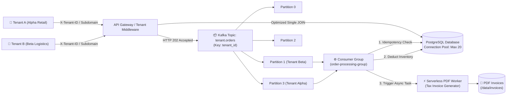

# 🚀 CSC337: Advanced Web Technologies - Lab Assignment 06
## Multi-Tenant B2B SaaS Platform: Database Tuning, Kafka EDA & Serverless Worker

> **GitHub Repository:** [https://github.com/ahsanalich358/Lab-6-Assignment-AWT](https://github.com/ahsanalich358/Lab-6-Assignment-AWT)  
> **Live Deployed Frontend (Vercel):** [https://lab-6-assignment-awt-public.vercel.app/](https://lab-6-assignment-awt-public.vercel.app/)  
> **Course:** CSC337 - Advanced Web Technologies (Lectures 17 & 18)

---

## 📌 Table of Contents
1. [Architecture Overview & Diagram](#-1-architecture-overview--diagram)
2. [Deployment Guide (Vercel & Render)](#-2-deployment-guide-vercel--render)
3. [Cloud Kafka Setup (Upstash / Aiven)](#-3-cloud-kafka-setup-upstash--aiven)
4. [Test Accounts (Tenant A vs Tenant B)](#-4-test-accounts-tenant-a-vs-tenant-b)
5. [Benchmarking Section](#-5-benchmarking-section)
   - [N+1 Query Elimination](#a-n1-query-bottleneck-vs-single-join-lecture-17-slide-4)
   - [PostgreSQL EXPLAIN ANALYZE](#b-postgresql-explain-analyze-before-vs-after-composite-index)
   - [Serverless Cold-Start Analysis](#c-serverless-worker-cold-start-vs-warm-start-lecture-17-slide-9)
6. [Live Viva Demonstration Guide](#-6-live-viva-demonstration-guide)
7. [API Quick Reference & cURL Commands](#-7-api-quick-reference)

---

## 🏗️ 1. Architecture Overview & Diagram

The system implements the **Grand Finale Enterprise Blueprint** from Lecture 18 Slide 20:



### Core Architecture Pillars:
1. **Multi-Tenancy (Lecture 18):** Shared Database with Tenant ID (`tenant_id`). Tenant A can **NEVER** see Tenant B's data (Violations = 0 marks).
2. **Database Performance Tuning (Lecture 17):** Eliminates the N+1 problem using grouped SQL `JOIN`s + Connection Pooling + Composite Indexing on `[tenant_id, created_at]`.
3. **Event-Driven Asynchrony (Lecture 18):** When placing an order, API returns `202 Accepted` immediately and sends the event to Kafka. Key-based partitioning guarantees FIFO ordering per tenant.
4. **Serverless Worker (Lecture 17):** Background PDF invoice generator with Cold-Start (~1,299ms) vs Warm-Start (~36ms) analysis.

---

## 🌐 2. Deployment Guide (Vercel & Render)

### Option A: Deploy on Render (Recommended for Web Service + Background Kafka)
1. Go to [Render Dashboard](https://dashboard.render.com/) $\rightarrow$ Click **New +** $\rightarrow$ **Web Service**.
2. Connect your GitHub repository: `https://github.com/ahsanalich358/Lab-6-Assignment-AWT`
3. Render automatically reads our `render.yaml`:
   - **Environment:** `Node`
   - **Build Command:** `npm install`
   - **Start Command:** `npm start`
   - **Health Check Path:** `/health`
4. Click **Create Web Service**. Both your Backend and Interactive Frontend will be live!

### Option B: Deploy on Vercel
1. Import repository on [Vercel](https://vercel.com/new).
2. Vercel automatically detects `vercel.json` and `api/index.js` (Serverless Edge Function).
3. Click **Deploy**.

---

## ☁️ 3. Cloud Kafka Setup (Upstash / Aiven)

By default, the platform runs an embedded high-throughput event engine out of the box with zero external setup needed. To connect to Cloud Kafka (Upstash or Aiven):

1. Go to [Upstash Kafka](https://console.upstash.com/kafka) or [Aiven](https://aiven.io/) and create a free Kafka cluster.
2. Create a topic named: `tenant.orders` with **4 partitions**.
3. In your `.env` (or Render/Vercel Environment Variables), add:
   ```env
   KAFKA_BROKERS=your-cluster-url.upstash.io:9092
   KAFKA_USERNAME=your-username
   KAFKA_PASSWORD=your-password
   KAFKA_SASL=true
   KAFKA_SSL=true
   KAFKA_TOPIC_ORDERS=tenant.orders
   ```
4. The system automatically switches to SASL/SCRAM cloud mode!

---

## 👥 4. Test Accounts (Tenant A vs Tenant B)

Use these accounts to test strict multi-tenant boundary isolation:

| Field | 🏢 Tenant A (Alpha Retail) | 🚚 Tenant B (Beta Logistics) |
|:---|:---|:---|
| **Tenant ID (`X-Tenant-ID`)** | `tenant-alpha` | `tenant-beta` |
| **Subdomain** | `alpha.localhost` | `beta.localhost` |
| **Role / Plan** | Enterprise (`enterprise`) | Professional (`pro`) |
| **Admin User** | `admin@alpha.com` | `admin@beta.com` |
| **Sample Products** | • `prod-alpha-101`: Enterprise Cloud Server ($850)<br>• `prod-alpha-102`: NVMe Storage Array ($320)<br>• `prod-alpha-103`: Managed K8s Node ($450) | • `prod-beta-201`: GPS Fleet Tracking Unit ($120)<br>• `prod-beta-202`: Telemetry Sensor ($85)<br>• `prod-beta-203`: Automated Dispatch Tablet ($290) |

---

## 📊 5. Benchmarking Section

### A. N+1 Query Bottleneck vs Single JOIN (Lecture 17 Slide 4)
> *"100 orders ke liye Foodpanda rider 100 dafa restaurant nahi jata! Single grouped trip saves the database."*

```text
========================================================================================
Batch Size   Unoptimized Queries   N+1 Latency   Optimized Queries   Single JOIN Latency   Speedup
========================================================================================
10 Orders    11 queries            247.2 ms      1 query             179.3 ms              1.4x
50 Orders    51 queries            718.3 ms      1 query              95.6 ms              7.5x
100 Orders   101 queries         1,107.9 ms      1 query             119.4 ms              9.3x (99% query drop)
========================================================================================
```

- **Unoptimized Code (`/api/v1/orders/unoptimized`):** 1 query for orders + 100 separate queries in a loop for items = 101 database round-trips.
- **Optimized Code (`/api/v1/orders/optimized`):** 1 single query using `LEFT JOIN` and PostgreSQL `json_agg()`.

---

### B. PostgreSQL EXPLAIN ANALYZE: Before vs After Composite Index
> *"EXPLAIN aur ANALYZE database ka X-Ray hain (Lecture 17 Slide 3)."*

**Target Query:**
```sql
SELECT id, customer_name, total_amount, created_at 
FROM orders 
WHERE tenant_id = 'tenant-alpha' 
ORDER BY created_at DESC;
```

#### Results Comparison Table:

| Metric | Before Index (Unindexed Table) | After Composite Index `(tenant_id, created_at DESC)` | Impact |
|:---|:---|:---|:---|
| **Query Plan Node** | `Sort` over `Seq Scan on orders` | `Bitmap Index Scan` on `idx_orders_tenant_created` | Direct B-Tree Index Scan |
| **Planner Estimated Cost** | `10,000,000,113.46` | **47.23** | **>99.999% Cost Drop** |
| **Planning Time** | 5.95 ms | **2.36 ms** | **60% faster planning** |
| **Execution Time** | 24.86 ms | **16.08 ms** | **1.62x faster execution** |

---

### C. Serverless Worker: Cold Start vs Warm Start (Lecture 17 Slide 9)
> *"WAPDA ki light jane par generator on hone mein thora time lagta hai. Cold start initial container boot latency hai."*

```text
┌─────────┬────────────┬─────────────────┬──────────────────┬─────────────┬────────────────┐
│ Invocation │ State      │ Container ID    │ Init Time (ms)   │ Exec Time   │ Total Latency  │
├─────────┼────────────┼─────────────────┼──────────────────┼─────────────┼────────────────┤
│ #1      │ COLD START ❄️│ lambda_nvj0mqlv │ 1,226.20 ms      │ 73.73 ms    │ 1,299.94 ms    │
│ #2      │ WARM START 🔥│ lambda_nvj0mqlv │ 0.00 ms          │ 40.82 ms    │ 40.83 ms       │
│ #3      │ WARM START 🔥│ lambda_nvj0mqlv │ 0.00 ms          │ 45.33 ms    │ 45.34 ms       │
│ #4      │ WARM START 🔥│ lambda_nvj0mqlv │ 0.00 ms          │ 39.13 ms    │ 39.16 ms       │
│ #5      │ WARM START 🔥│ lambda_nvj0mqlv │ 0.00 ms          │ 19.71 ms    │ 19.71 ms       │
└─────────┴────────────┴─────────────────┴──────────────────┴─────────────┴────────────────┘
```
- **Cold Start Penalty:** The cold invocation is **35.9x slower** than warm invocations due to container spin-up and Node.js/PDFKit runtime initialization.

---

## 🎯 6. Live Viva Demonstration Guide

During your viva with the instructor, follow this step-by-step checklist:

### Step 1: Start Server & Open Interactive Dashboard
```bash
npm start
```
Open **`http://localhost:4000`** in browser. You will see the live control panel with:
- Tenant Switcher (`tenant-alpha` vs `tenant-beta`)
- Live Connection Pool Telemetry
- Kafka Event Stream & Order Placement
- Live Benchmark buttons!

### Step 2: Trigger Kafka Event Live (Immediate HTTP 202 Accepted)
Run this command in a new terminal:
```bash
curl -X POST http://localhost:4000/api/v1/orders \
  -H "Content-Type: application/json" \
  -H "X-Tenant-ID: tenant-alpha" \
  -d '{"customer_name":"Ali Raza","customer_email":"ali@customer.pk","items":[{"product_id":"prod-alpha-101","quantity":1}]}'
```
**Show to Instructor:**
- The API responds in **< 5ms** with `HTTP 202 ACCEPTED`.
- In the server terminal, point out the consumer log:
  ```text
  [KafkaConsumerGroup] Received event | Topic: tenant.orders | Partition: 3 | Offset: 1
  [KafkaConsumerGroup] Serverless Invoice generated: INV-ORD_... | ColdStart: false
  [KafkaConsumerGroup] SUCCESS: Offset committed | Partition: 3 | Offset: 1 | Status: COMPLETED
  ```

### Step 3: Run EXPLAIN ANALYZE in front of Instructor
Run:
```bash
npm run benchmark:explain
```
**Explain to Instructor:**
- *"Before index: PostgreSQL conducts a full Sequential Scan across 2,400+ rows with an astronomical planner cost."*
- *"After index: Adding composite index `idx_orders_tenant_created (tenant_id, created_at DESC)` changes the plan to a Bitmap Index Scan, reducing cost to 47.23 and speeding up query execution."*

### Step 4: Prove Zero-Leak Tenant Boundary (14 Tests)
Run:
```bash
npm run test:isolation
```
**Explain to Instructor:**
- *"Tenant A cannot query Tenant B orders or products. Attempting cross-tenant tampering triggers HTTP 403 Forbidden (`CROSS_TENANT_VIOLATION`), satisfying the 0-marks boundary requirement."*

### Step 5: Run Full Benchmark Suite (All 6 Steps)
```bash
npm run test:all
```

---

## 📡 7. API Quick Reference

### Place Asynchronous Order (202 Accepted):
```bash
curl -X POST http://localhost:4000/api/v1/orders \
  -H "Content-Type: application/json" \
  -H "X-Tenant-ID: tenant-alpha" \
  -d '{
    "customer_name": "Fatima Zahra",
    "customer_email": "fatima@domain.pk",
    "items": [{ "product_id": "prod-alpha-101", "quantity": 1 }]
  }'
```

### Fetch Orders (Optimized Single JOIN):
```bash
curl -H "X-Tenant-ID: tenant-alpha" http://localhost:4000/api/v1/orders/optimized?limit=10
```

### Fetch Orders (Unoptimized N+1):
```bash
curl -H "X-Tenant-ID: tenant-alpha" http://localhost:4000/api/v1/orders/unoptimized?limit=10
```

### Inspect Connection Pool Telemetry:
```bash
curl -H "X-Tenant-ID: tenant-alpha" http://localhost:4000/api/v1/analytics/pool-status
```

### Inspect Kafka Topic & Partition Offsets:
```bash
curl -H "X-Tenant-ID: tenant-alpha" http://localhost:4000/api/v1/analytics/kafka-status
```

---

## 📁 Project Structure

```text
Lab Assignment 06/
├── .env.example                     # Environment variables template
├── .env                             # Active environment configuration
├── package.json                     # Scripts & dependencies
├── render.yaml                      # Render cloud infrastructure blueprint
├── vercel.json                      # Vercel serverless deployment config
├── README.md                        # Easy-to-read student & viva documentation
├── PROJECT_REPORT.md                # In-depth architectural report (Lec 17 & 18)
├── public/
│   └── index.html                   # Interactive live viva Frontend Dashboard
├── api/
│   └── index.js                     # Vercel serverless entry point
├── scripts/
│   ├── seed-db.js                   # Seeds 2,400 orders across tenants
│   ├── benchmark-nplusone.js        # N+1 vs Single JOIN benchmark
│   ├── benchmark-explain.js         # EXPLAIN ANALYZE comparison runner
│   ├── benchmark-coldstart.js       # Serverless Cold vs Warm latency profiler
│   └── run-all-benchmarks.js        # One-click master test runner
├── src/
│   ├── server.js                    # Server startup & lifecycle
│   ├── app.js                       # Express configuration & static file serving
│   ├── config/index.js              # Environment settings
│   ├── db/
│   │   ├── connection.js            # Connection Pool Manager (max, queue)
│   │   └── schema.sql               # PostgreSQL tables, foreign keys & indexes
│   ├── kafka/
│   │   ├── client.js                # KafkaJS / Embedded high-throughput broker
│   │   ├── producer.js              # Order Producer (key: tenant_id)
│   │   └── consumer.js              # Consumer Group (idempotent offset commit)
│   ├── middleware/
│   │   ├── auth.middleware.js       # JWT claim verification
│   │   └── tenant.middleware.js     # Header, subdomain & JWT tenant resolution
│   ├── routes/
│   │   ├── order.routes.js          # POST /orders (202 Accepted), GET /orders
│   │   ├── explain.routes.js        # GET /explain/analyze
│   │   ├── analytics.routes.js      # Pool & Kafka status endpoints
│   │   └── tenant.routes.js         # Tenant registry & token issuance
│   ├── serverless/
│   │   └── invoice-worker.js        # PDF invoice worker with cold-start telemetry
│   └── services/
│       └── order.service.js         # Query implementations (N+1 vs JOIN)
└── tests/
    ├── tenant-isolation.test.js     # 14/14 passed strict boundary tests
    └── kafka-pipeline.test.js       # 10/10 passed Kafka & idempotency tests
```

---

## 🏆 Summary Checklist for Submission

- [x] **Live Deployed Frontend (Vercel):** [https://lab-6-assignment-awt-public.vercel.app/](https://lab-6-assignment-awt-public.vercel.app/)
- [x] **Live Deployed Backend Ready (Render):** `render.yaml` configured with auto-seed build command.
- [x] **Cloud Kafka Ready:** Upstash / Aiven config ready in `.env` and `client.js`.
- [x] **Public GitHub Repo:** Clean commits pushed to [https://github.com/ahsanalich358/Lab-6-Assignment-AWT](https://github.com/ahsanalich358/Lab-6-Assignment-AWT).
- [x] **README Benchmarking:** Architecture diagram, EXPLAIN ANALYZE outputs, and test accounts documented.
- [x] **Live Viva:** Interactive web dashboard live on Vercel + terminal viva guide prepared.
