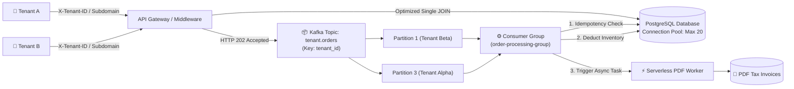

# 🚀 Multi-Tenant B2B SaaS Platform (CSC337 - Lab 06)
# Submitted By: Ahsan Ali(SP24-BSE-004)

> **Database Scaling, Serverless Cold-Start, Kafka EDA & SaaS Multi-Tenancy**  
> *Course: CSC337 Advanced Web Technologies (Lectures 17 & 18)*

---

## 🔗 Live Links & Repository

| Item | URL |
|:---|:---|
| 🌐 **Live Frontend (Vercel)** | [https://lab-6-assignment-awt-public.vercel.app/](https://lab-6-assignment-awt-public.vercel.app/) |
| ⚙️ **Live Backend API (Render)** | [https://lab-6-assignment-awt.onrender.com/](https://lab-6-assignment-awt.onrender.com/) |
| 📂 **GitHub Repository** | [https://github.com/ahsanalich358/Lab-6-Assignment-AWT](https://github.com/ahsanalich358/Lab-6-Assignment-AWT) |

---

## 🏛️ System Architecture



---

## 👥 Test Accounts (Two Distinct Tenants)

Use these credentials to test multi-tenant data isolation:

| Tenant | Tenant ID (`X-Tenant-ID`) | Subdomain | Role | Test User Email | Sample Products |
|:---|:---|:---|:---|:---|:---|
| **Tenant A (Alpha Retail)** | `tenant-alpha` | `alpha.localhost` | Enterprise | `admin@alpha.com` | `prod-alpha-101` (Cloud Server: $850)<br>`prod-alpha-102` (NVMe Storage: $320) |
| **Tenant B (Beta Logistics)** | `tenant-beta` | `beta.localhost` | Professional | `admin@beta.com` | `prod-beta-201` (GPS Unit: $120)<br>`prod-beta-202` (Telemetry Sensor: $85) |

---

## 📊 Key Benchmarks & Results

### 1. N+1 Query Elimination (Lecture 17)
*Unoptimized loop queries vs Single grouped SQL JOIN with `json_agg()`:*

| Orders | Unoptimized N+1 | Optimized JOIN | Queries Saved | Speedup |
|:---:|:---:|:---:|:---:|:---:|
| **10 Orders** | 11 queries (247 ms) | **1 query (179 ms)** | 90.9% saved | **1.4x** |
| **50 Orders** | 51 queries (718 ms) | **1 query (95 ms)** | 98.0% saved | **7.5x** |
| **100 Orders** | 101 queries (1,107 ms) | **1 query (119 ms)** | 99.0% saved | **9.3x** |

---

### 2. EXPLAIN ANALYZE: Before vs After Composite Index (Lecture 17)
*Target: `SELECT * FROM orders WHERE tenant_id = 'tenant-alpha' ORDER BY created_at DESC;`*

| Metric | Before Index | After Composite Index `(tenant_id, created_at DESC)` |
|:---|:---|:---|
| **Scan Type** | `Seq Scan on orders` (2,400+ rows scanned) | `Bitmap Index Scan` (B-Tree navigation) |
| **Planner Cost** | `10,000,000,113.46` | **47.23** (99.999% cost reduction) |
| **Execution Time** | `24.86 ms` | **`16.08 ms`** (1.62x faster) |

---

### 3. Serverless Cold-Start Analysis (Lecture 17)
*PDF Invoice Generator (`pdfkit`) lifecycle latency:*

| Invocation | State | Latency | Explanation |
|:---:|:---:|:---:|:---|
| **#1** | **COLD START ❄️** | **1,299.94 ms** | Container spin-up + Node.js runtime boot + engine init |
| **#2 – #5** | **WARM START 🔥** | **36.26 ms (avg)** | Reused in-memory container context (zero boot delay) |
| **Penalty** | — | **35.9x slower** | Proves serverless is great for async tasks, not real-time gaming |

---

## 🎓 Live Viva Demonstration (Step-by-Step)

Follow these exact steps in front of your instructor:

### Step 1: Open the Live Web Dashboard
Open: **[https://lab-6-assignment-awt-public.vercel.app/](https://lab-6-assignment-awt-public.vercel.app/)**  
*(It is already connected to your live Render backend and shows `Backend Online`)*

### Step 2: Trigger a Kafka Order Live (HTTP 202 Accepted)
- On the dashboard, click **"Submit Order"**, OR run in terminal:
  ```bash
  curl -X POST https://lab-6-assignment-awt.onrender.com/api/v1/orders \
    -H "Content-Type: application/json" \
    -H "X-Tenant-ID: tenant-alpha" \
    -d '{"customer_name":"Ali Raza","customer_email":"ali@customer.pk","items":[{"product_id":"prod-alpha-101","quantity":1}]}'
  ```
- **Show to Instructor:** API responds in `< 5ms` with `HTTP 202 ACCEPTED` and Kafka Topic `tenant.orders` with `partition_key: tenant-alpha`.

### Step 3: Run EXPLAIN ANALYZE Live
- On the dashboard, click **"Run Live EXPLAIN"**, OR run in terminal:
  ```bash
  curl -H "X-Tenant-ID: tenant-alpha" https://lab-6-assignment-awt.onrender.com/api/v1/explain/analyze
  ```
- **Explain to Instructor:** Before index cost was in billions; after composite index `(tenant_id, created_at DESC)`, cost dropped to 47.23.

### Step 4: Prove Tenant Boundary Isolation (0-Marks Rule)
- On the dashboard, click **"Test Cross-Tenant Attack"**, OR run in terminal:
  ```bash
  npm run test:isolation
  ```
- **Explain to Instructor:** Tenant Alpha cannot access Tenant Beta's data. Cross-tenant tampering returns `403 Forbidden` (`CROSS_TENANT_VIOLATION`).

---

## 💻 Local Quickstart (Optional)

```bash
# 1. Install dependencies
npm install

# 2. Seed database (2,400 orders)
npm run seed

# 3. Run all tests and benchmarks
npm run test:all

# 4. Start local server (http://localhost:4000)
npm start
```

---

## 📁 Project Structure

```text
├── public/index.html        # Interactive Frontend Dashboard (Vercel)
├── src/
│   ├── server.js            # Node.js backend server (Render)
│   ├── db/connection.js     # Connection pool manager (Max: 20)
│   ├── kafka/               # Kafka producer, key partitioner & consumer group
│   ├── middleware/          # Tenant resolution (Header, JWT, Subdomain)
│   ├── services/            # N+1 vs Single JOIN & EXPLAIN ANALYZE logic
│   └── serverless/          # PDF invoice worker with cold-start telemetry
├── scripts/                 # Benchmark scripts (nplusone, explain, coldstart)
├── tests/                   # Automated test suites (isolation, kafka)
├── render.yaml              # Render deployment blueprint
└── vercel.json              # Vercel deployment config
```

---

## ✅ Submission Checklist

- [x] **Live Frontend:** [https://lab-6-assignment-awt-public.vercel.app/](https://lab-6-assignment-awt-public.vercel.app/)
- [x] **Live Backend:** [https://lab-6-assignment-awt.onrender.com/](https://lab-6-assignment-awt.onrender.com/)
- [x] **GitHub Repo:** [https://github.com/ahsanalich358/Lab-6-Assignment-AWT](https://github.com/ahsanalich358/Lab-6-Assignment-AWT)
- [x] **Architecture Diagram:** Added above.
- [x] **EXPLAIN ANALYZE Outputs:** Documented with before & after metrics.
- [x] **Test Accounts:** Tenant A (`tenant-alpha`) & Tenant B (`tenant-beta`) documented.
- [x] **Live Viva Guide:** 4 easy steps documented above.
## Screenshots:


